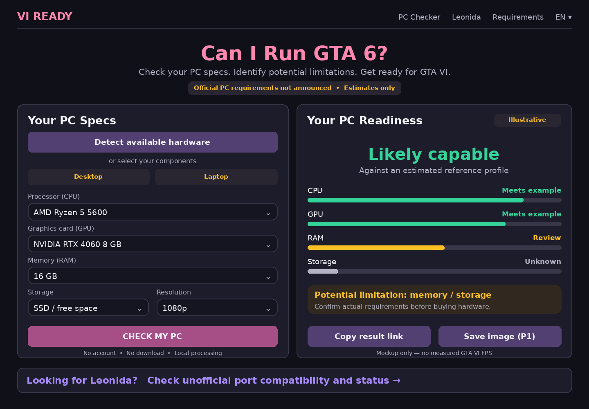
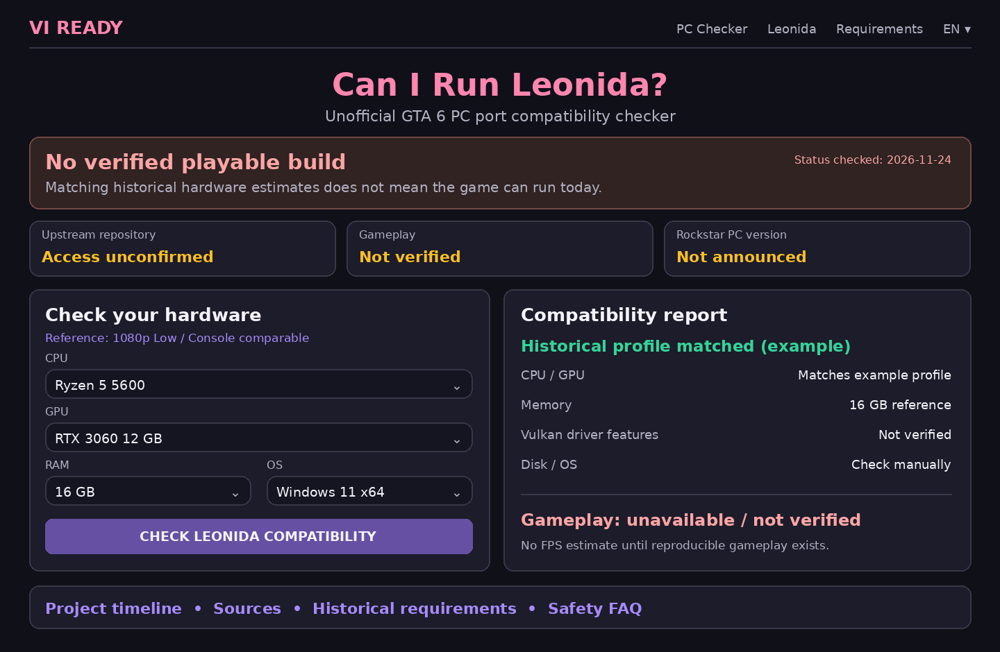
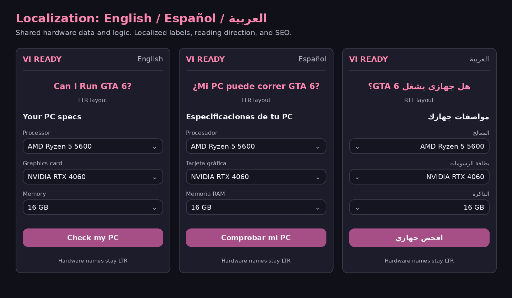
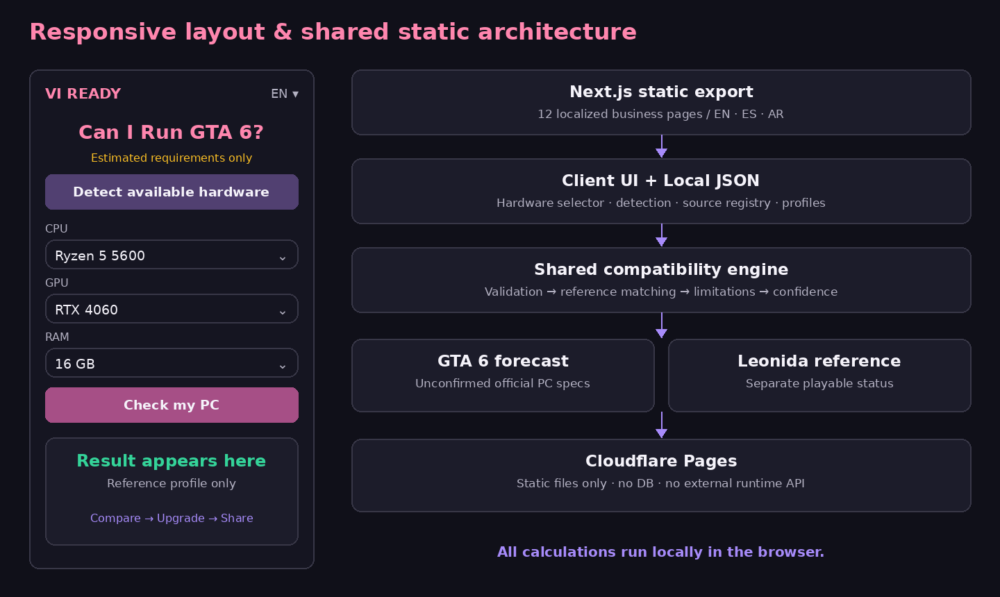
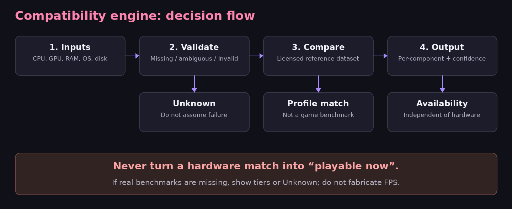
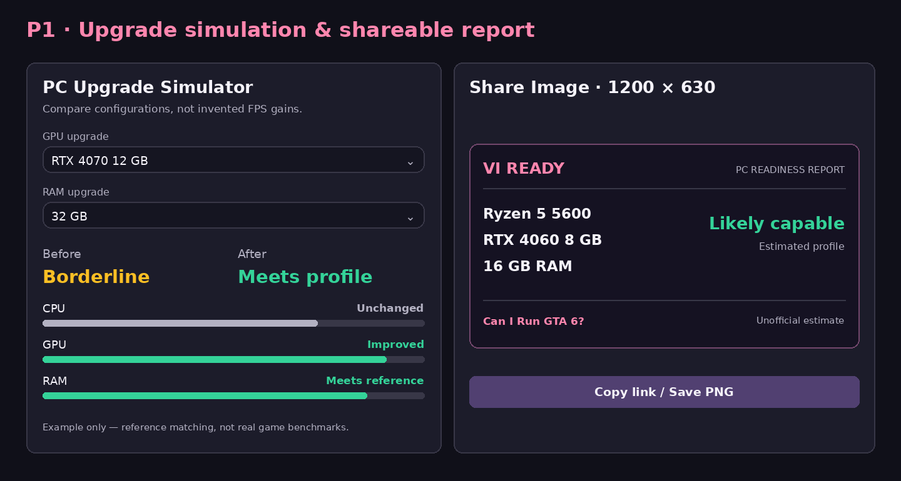

# GTA 6 PC Readiness Checker
## 产品分析、UI/UX 设计与 Codex 开发规格书

**版本：** v1.0 · 2026-11-24　|　**项目代号：** VI Ready（暂定，正式发布前核查域名及商标）  
**目标关键词：** `can i run gta 6`、`can i run leonida`  
**首发语言：** English / Español / العربية（EN、ES、AR）  
**技术目标：** Next.js + TypeScript + Tailwind CSS + 本地 JSON + Cloudflare Pages 静态部署。  
**文档用途：** 供 Codex 作为实现依据。本文件的需求与验收标准优先于线框图中的演示数值。所有图片为原创布局示意，不是实际游戏画面、竞品截图或硬件实测。

## 0. 给 Codex 的执行说明

请阅读本文件全部章节以及 `assets/` 内的六张设计图，再开始实现。先检查当前仓库、运行环境和已有组件；若为空则初始化项目，若非空则尽量保留现有代码与路由。按照 P0 → P1 → P2 实施，默认先交付 P0，禁止为了赶进度伪造硬件数据、官方配置、性能分或 Leonida 可玩状态。P0 验收后再做 P1；P2 只规划，不提前建设后台或付费系统。

P0 最终交付：12 个核心业务页面、三语完整核心工具、两套独立评估配置、真实可追溯的硬件数据、自动检测与手动输入、参考配置报告、URL 分享、SEO、数据校验、自动化测试及静态产物。测试数据可用人工 fixture，但必须与生产数据隔离。实际没有可靠基准数据时展示 `Unknown`，并记录缺口，不能假装已完成性能数据库建设。

---

## 1. 项目分析与决策依据

### 1.1 搜索机会及用户需求

| 维度 | can i run gta 6 | can i run leonida |
|---|---|---|
| 意图 | 我的 PC 能否运行 GTA 6、配置是否够、要升级什么 | 非官方移植项目是否能在我的 PC 上运行、目前能否玩 |
| 生命周期 | PC 版消息、发布及后续硬件更新驱动，偏长期 | 项目进度及社交热度驱动，偏短期 |
| 主要工具 | 官方 PC 版预测参考配置检测 | 历史硬件档位及技术兼容性检查 |
| 真实游戏 FPS | 官方 PC 基准未建立，P0 不显示 | 无可复现玩法基准，禁止输出 FPS |
| 上线优先级 | P0 | P0 |

用户提供的哥飞分析：`can i run gta 6` 月搜索量约 260，KD 14.9，低 DR 竞品存在；`can i run leonida` 在关键词规划师暂未积累可靠搜索量；地图相关 where 词的竞争更强，原建议的 35–70 个引用域仅为估算。以上为用户提供的第三方数据，**未独立重查或保证排名**，需记录数据日期、国家、来源口径，不得宣传为已核实搜索量。

分析逻辑：先区分两种搜索意图，再检验是否有真实可交付功能；根据现有竞品定位差异化；通过共享硬件引擎降低维护成本；短期 Leonida 流量和长期 GTA 6 PC 需求解耦；根据地区热度与本地化边际成本优先三语；上线后根据真实 GSC/GA4 数据调整，而非按热度指数推算访问量。

### 1.2 当前事实与不确定性（核查日期 2026-11-24）

| 事实/状态 | 证据与处理 |
|---|---|
| GTA VI 2026-11-19 发售 | Rockstar 官方发售公告 [S1] |
| 官方发售平台 PS5、Xbox Series X/S | Rockstar 平台信息 [S2]；核查时未找到官方 PC 发布日期或 PC 配置 |
| Leonida 非 Rockstar 官方移植 | 项目自述为 Xbox Series 版本静态重编译方向，面向 Windows、Vulkan [S3] |
| Leonida 尚不能启动游戏 | 项目官网明确表示尚未 boot [S3]；第三方报道也确认 [S4] |
| 仓库状态不稳定 | 上游项目仓库直接访问此次返回 404；搜索索引和镜像仍有记录。不能据此断言永久关闭、遭封禁或已恢复 |
| 历史硬件配置存在 | Survival Servers 引用项目旧检测器的两套社区参考档位 [S5]，不是官方游戏配置、不是实测 |

**发布规则：** Codex 上线前重新核实 S1–S5，状态文件必须含 `checkedAt`、证据 URL、证据类型、可玩性、上游可访问性及明确的不确定性。不能把镜像源码存在当作可玩证明。若有冲突或无法访问，保留最后一次核实的记录并标注 stale/unknown。本站不提供游戏文件、破解、密钥、绕过保护或第三方安装包。

### 1.3 竞品分析

| 竞品 | 方向 | 借鉴点 / 超越点 |
|---|---|---|
| [Can I Run GTA 6](https://www.can-i-run-gta-6.com/) | 专项 PC 配置性能查询 | 快速选择硬件与型号长尾；本站强调可解释性、透明来源 |
| [Survival Servers Leonida Checker](https://www.survivalservers.com/tools/gta-6/can-i-run-leonida/) | 两套 Leonida 历史档位及检测 | 独立可玩状态、社区参考配置；本站补充三语、结果迁移 |
| [Leonida Intel PC Checker](https://leonida-intel.com/pc-checker/) | 画质、分辨率、目标 FPS 等高级参数 | 分阶段做进阶选项，不在 P0 过度复杂化 |
| [GTA 6 Coverage Checker](https://gta6coverage.com/tools/can-i-play-gta-6) | PC 配置与性能预测 | P1 研究配置文本导入，降低手动录入成本 |

核心差异化：自动识别可获取的硬件、明确每项限制、升级模拟（P1）、无账号无下载安装、本地处理、三语原生页面、参考数据可追溯。不是追求更漂亮的虚假 FPS 数字。

### 1.4 原建议采纳与修正

| 原建议 | 最终决策 | 理由 |
|---|---|---|
| 首页即配置检测器 | 采纳 | 工具优先，首屏完成主要任务 |
| 两个页面共用检测器 | 部分采纳 | 共享组件与引擎，独立 profile 和可玩性 |
| CPU/GPU 1–100 + 显存 | 修正 | CPU/GPU 不同量纲；需要标准、来源、设备类型与缺失值处理 |
| `min(CPU 分,GPU 分)` | 修正 | 先各自归一化到参考档位，再检查内存、显存和必要兼容条件 |
| 年份+预算推测型号 | 不做 | 同价同年差异极大；提供系统查看指引 |
| 预计 1080p FPS | 推迟 | 无真实测试，先显示档位及不确定性 |
| URL/图片分享 | 采纳 | URL P0、Canvas PNG P1 |
| 参数页 canonical | 采纳 | 必须指向当前语言的当前工具页，不是一律英语首页 |
| 地图 where 内页 | P2 | 与硬件核心意图不同，需独立验证 |
| 禁止盗版下载 | 采纳 | 同时避免品牌仿冒及误导 |

---

## 2. 信息架构：首版 12 个核心页面

同一域名，英语根路径，其他语言子目录。采用 trailingSlash 统一策略，以下为最终路由。

| 业务页 | 英语 | 西班牙语 | 阿拉伯语 | 优先级 |
|---|---|---|---|---|
| GTA 6 checker | `/` | `/es/` | `/ar/` | P0 |
| Leonida checker | `/can-i-run-leonida/` | `/es/can-i-run-leonida/` | `/ar/can-i-run-leonida/` | P0 |
| PC requirements | `/gta-6-pc-requirements/` | `/es/requisitos-gta-6-pc/` | `/ar/gta-6-pc-requirements/` | P0 |
| PC release status | `/gta-6-pc/` | `/es/gta-6-pc/` | `/ar/gta-6-pc/` | P0 |

12 个指核心业务页，不含 About、Privacy、Methodology 等支持页。支持页首版至少具备真实内容，按三语生成，或确保相应语言的明确可用链接；不能生成空白 hreflang 占位页。全站导航：首页工具 / Leonida / Requirements / PC Status / 语言选择；页脚：四个业务入口、方法、隐私、关于、独立站声明、数据更新日期。Leonida 状态先合并于该工具页，不单独建重复内页。

## 3. 视觉规范与页面原型

设计方向：迈阿密日落色系 + 专业 PC 硬件面板，避免仿冒 Rockstar 页面、避免大量游戏截图和动画。原型里的具体型号、分数、档位及条形图均仅作 UI 示例，不可复制为生产性能数据。图片是布局参考，实际组件需可访问、响应式、可操作。

| Token | 值 | 用途 |
|---|---|---|
| `--bg` | `#101019` | 全局深色背景 |
| `--surface` | `#1C1C2A` | 面板 |
| `--border` | `#383747` | 表单及分隔线 |
| `--text` | `#F5F3FA` | 正文 |
| `--muted` | `#B3B1C2` | 辅助说明 |
| `--accent` | `#FF86AE` | 主标题、重点链接 |
| `--secondary` | `#A78BFA` | 次要强调 |
| `--success` | `#34D399` | 达到参考条件 |
| `--warning` | `#FBBF24` | 接近、待验证 |
| `--danger` | `#FCA5A5` | 明确限制、不可用 |

最大内容宽度约 1280px；桌面 1024px 以上双列 48:52，间距 24px；平板和移动端单列，16px 页面边距；可点击目标至少 44px。H1 40–48px 桌面/28–32px 手机；正文 16px；圆角 12–16px。状态不可仅靠颜色表达，需图标和文本。字体采用系统字体或合法自托管字体；阿拉伯语 Cairo/IBM Plex Sans Arabic 可选，检查授权和体积。减少大图，首屏不使用视频背景。

### 3.1 首页（主工具）



首屏从上到下：紧凑导航；H1 `Can I Run GTA 6?`；一句说明；明确 PC 官方配置尚未公布的提示；左侧硬件选择，右侧实时或提交后结果；底部 Leonida 快速入口。

| 左侧输入区 | 行为 | 必填 |
|---|---|---|
| Detect available hardware | 点击后本地获取可用 GPU、OS 等，用户确认 | 否 |
| Desktop / Laptop / Other | 区分 GPU 版本，移动设备给出合理引导 | 是 |
| Processor | 支持品牌、型号、别名搜索与键盘操作 | 是（允许 Unknown） |
| Graphics Card | 区分桌面/移动、显存变体、集显 | 是（允许 Unknown） |
| RAM | 4/8/12/16/24/32/48/64/96/128 GB 或自定义、Unknown | 是（允许 Unknown） |
| VRAM | 由型号推导，可覆盖；集显共享内存不可冒充独显显存 | 否 |
| OS / architecture | Windows 10/11、Linux、macOS、Other、Unknown；x64/ARM/Unknown | 否（Leonida 要重点显示） |
| Storage type / free space | SSD/HDD/Unknown；可用 GB，不填不推测 | 否 |
| Target resolution | 1080p 默认；其他档位仅在模型有依据时给出结果 | 否 |
| Check My PC | 校验并渲染结果，更新本地配置及可分享 URL | — |

首次打开：字段为空或明确未选择；右侧显示待检测占位、输入指引，不出现虚假绿色结果。完成检测后展示：

- 当前可玩性（未发布官方 PC 版，独立于参考性能）。
- 参考档位匹配结论、可信度、数据版本和来源。无可信模型则显示 Unknown，不给 78/100 之类的伪精确分数。
- CPU、GPU、RAM、VRAM、OS、存储逐项报告；列出最明显的参考配置差距，而非声称测出了实际游戏瓶颈。
- 参考配置与用户配置对照；链接升级模拟（P1）；复制分享链接；导出图片（P1）。
- 未知字段补全入口，修改配置后重新计算或明确标记旧结果已过期。

首屏以下模块：

| 顺序 | 模块 | 说明 |
|---|---|---|
| 1 | Estimated System Requirements | 预计入门/推荐参考配置、用户配置、状态、来源 |
| 2 | Performance by Resolution | P1，1080p/1440p/4K 有依据时给定性档位，否则 Unknown |
| 3 | What Should I Upgrade? | P0 解释限制；P1 支持变更 CPU/GPU/RAM 模拟 |
| 4 | Popular Graphics Cards | 热门 GPU 一键预选；P1 有独立内容的型号页 |
| 5 | Leonida Checker | 非官方项目入口及状态 |
| 6 | PC Release Status | 官方消息摘要与详情页链接 |
| 7 | Methodology | 预测方法、证据、数据版本、限制 |
| 8 | FAQ | PC 版是否推出、笔记本、显存、自动检测限制等 |

### 3.2 Leonida 页面



首屏必须先解释 Leonida 是第三方非官方项目、目前无已核实可玩版本，再让用户检测。顶部状态条分别显示 repository、playable、official PC；状态不可用不等于用户硬件差。

检测器额外强调 OS/架构、Vulkan 驱动能力、磁盘空间、运行时与完整开发构建的区别。支持 `1080p Low historical estimate`、`Xbox Series X comparable historical estimate` 两个档位；选择档位后对照对应条件。

| 项目 | 1080p Low 历史参考 | Xbox Series X 对标历史参考 |
|---|---|---|
| CPU | i5-12400F 或 Ryzen 5 5600 | Ryzen 7 3700X 或 Ryzen 5 5600 |
| NVIDIA GPU | RTX 3060 12GB | RTX 3060 Ti 或 RTX 3070 |
| AMD GPU | RX 6700 XT | RX 6700 XT 或 RX 6800 |
| RAM | 16 GB | 32 GB |

来源 [S5]；不是实测 FPS 或最低/推荐官方配置。参考型号为各平台的候选锚点，需先取得可合法使用的同口径基准，不能将各品牌分数直接跨库混算。项目官网提到 Windows 10/11 与 Vulkan，Linux 工具链/Wine 测试不等于 Linux 原生游戏支持；macOS/ARM 不能宣称支持。历史资料对磁盘大小存在不同阶段口径（约 30GB runtime、数百 GB 完整工具流程）；应注明阶段、版本及来源，不能把运行时空间当作完整游戏安装大小 [S3][S5]。

下半页：What is Leonida → historical requirements → technical compatibility → timeline → Leonida vs official PC → safety notice → FAQ → methodology/sources。时间线只显示有证据的事件，不编造启动、发布或停更日期。当前状态更新文件驱动；过期则显示最后核查日期和待核实状态。

### 3.3 PC requirements / PC release status

| 页面 | 内容 |
|---|---|
| Requirements | 首段回答官方配置是否公布；官方/预测分栏；CPU、GPU、RAM、VRAM、存储表；来源；1080p 等档位限制；检测 CTA；FAQ |
| PC Status | 首段回答 PC 版是否已宣布、日期是否已确定；官方平台；官方公告时间线；区分官方/媒体/传闻；检测器入口；FAQ |

两页均使用静态 SSR/SSG 可读 HTML，不把关键文字藏在 JavaScript 后面。官方公布配置后，通过版本化 profile 更新，历史预测保留清晰标识。不要填充虚构发布日期。

### 3.4 三语和移动端布局





移动端：导航折叠，输入表单在结果之前，检查完成后用 `scrollIntoView` 定位报告并设置可访问焦点；尊重 reduced motion，不能强制反复跳动。表格可以横向滚动或改成逐项卡片；避免全页横向溢出。使用 320/375/390/768/1024/1440px 验收。RTL 需要真正镜像导航、表单、间距及对齐，不能仅改变文字方向；硬件型号、数字和单位用 `bdi` 或 `dir="ltr"` 处理，保证英文型号顺序正确。

---

## 4. 多语言与关键词策略

用户观察到英语、阿拉伯语、西班牙语地区热度高。Google Trends 地区指数是相对热度，不能推导绝对搜索量或用户语言。三语首发是由于工具高度可复用而做出的产品选择，非已验证三语流量相等。

| 语言 | 优先级 | 市场 | 策略 |
|---|---|---|---|
| EN | P0 | 美国、英国、加拿大、印度等英语用户 | 根路径 |
| ES | P0 | 墨西哥、西班牙、阿根廷、哥伦比亚等 | 通用西语，不拆地区版本 |
| AR | P0 | 沙特、埃及、伊拉克、阿联酋等 | 现代标准阿拉伯语，RTL |
| PT-BR | P1 验证 | 巴西 | 通过搜索和 GSC 数据决定 |
| FR / DE | P2 验证 | 法语/德语市场 | 不提前建设 |

### 4.1 本地关键词候选（均待实际搜索量验证）

| EN | ES | AR |
|---|---|---|
| can i run gta 6 | mi pc puede correr gta 6 | هل جهازي يشغل GTA 6 |
| can my pc run gta 6 | mi pc puede ejecutar gta 6 | هل يمكن لجهازي تشغيل GTA 6 |
| gta 6 pc requirements | requisitos gta 6 pc | متطلبات تشغيل GTA 6 على الكمبيوتر |
| gta 6 system requirements | requisitos mínimos gta 6 | متطلبات تشغيل GTA 6 |
| gta 6 pc checker | comprobar requisitos gta 6 | فحص مواصفات الكمبيوتر لتشغيل GTA 6 |
| can i run leonida | mi pc puede correr leonida | هل جهازي يشغل Leonida |
| leonida system requirements | requisitos leonida | متطلبات تشغيل Leonida |

英文品牌、GPU/CPU 型号和 canonical ID 不翻译。界面文字、状态、错误、FAQ、分享文本、SEO 元数据、日期格式全部本地化。不可仅翻译 H1 而主体英文。正式上线前人工审查 ES、AR 的自然性和技术术语。

### 4.2 核心文案

| 字段 | EN | ES | AR |
|---|---|---|---|
| 首页 H1 | Can I Run GTA 6? | ¿Mi PC puede correr GTA 6? | هل جهازي يشغل GTA 6؟ |
| Leonida H1 | Can I Run Leonida? | ¿Mi PC puede correr Leonida? | هل جهازي يشغل Leonida؟ |
| Your PC Specs | Your PC Specs | Especificaciones de tu PC | مواصفات جهازك |
| CPU | Processor | Procesador | المعالج |
| GPU | Graphics Card | Tarjeta gráfica | بطاقة الرسومات |
| Check CTA | Check My PC | Comprobar mi PC | افحص جهازي |
| 未公布提示 | Official PC requirements have not been announced. | Aún no se han anunciado los requisitos oficiales para PC. | لم يتم الإعلان بعد عن متطلبات تشغيل نسخة الكمبيوتر الرسمية. |
| Leonida 不可玩 | No verified playable build | No hay una versión jugable verificada | لا توجد نسخة قابلة للعب تم التحقق منها |

使用 `next-intl` 或轻量自有静态字典（禁止动态服务器依赖）。语言切换是真实 `<a href>`/Next Link，保留合法配置查询参数和当前业务页，不重定向至每个语言的首页。切换期间不丢 CPU/GPU/RAM，localStorage 跨语言共用同一配置 schema。

---

## 5. 功能规格与硬件数据

### 5.1 数据库建设

本地 JSON，无数据库。目标覆盖量是 **410 款**：桌面 CPU 120、桌面独显 120、移动 CPU 80、移动 GPU 60、集显 30。此为覆盖目标，不能为凑数量而虚构参数。优先 Steam Hardware Survey 的常见型号及其变体；P0 先落实高频型号，报告实际可核实覆盖数量及缺失项，P1 再补足长尾。需包含 Intel、AMD、NVIDIA；Apple/ARM 可作为兼容性说明，不能默认具备 Windows 游戏能力。

| 来源 | 用途 | 限制 |
|---|---|---|
| NVIDIA / AMD / Intel 官方 | 型号、显存、架构、规格 | 遵守使用条款，保存 URL |
| Steam Hardware Survey | 选择覆盖优先级 | 不代表具体玩家或站点的分布 |
| 自测、明确授权或开放许可的基准 | 相对性能计算 | 统一测试标准、版本、单位，记录许可 |
| TechPowerUp / Notebookcheck / Tom's Hardware | 研究硬件及性能梯队 | 仅在许可允许时抽取/公开数据；不得复制完整库 |
| PassMark | 了解性能数据市场 | 当前服务说明限制面向公众的配置检测网站使用 [S8]，不要批量抓取或展示其分数 |
| Rockstar / Leonida | 官方及项目历史参考 | 分清官方、社区、预测 |

TechPowerUp 提供数据库授权 [S7]。未确定授权的数据不得导入生产，AI 不得生成伪基准。初期如果只有硬件规格，可展示规格及历史参考型号的精确匹配，其他型号性能判定 Unknown；不能把硬件代际、核心数或显存单独当作可靠性能评分。

```ts
// 示例数据契约，字段允许 null；真实生产记录必须有证据
export type DeviceType = 'desktop' | 'laptop' | 'integrated' | 'other';
export interface Evidence {
  id: string;
  url: string;
  publisher: string;
  kind: 'official' | 'community' | 'licensed-benchmark' | 'self-test' | 'forecast';
  checkedAt: string;
  license: string | null;
  notes?: string;
}
export interface BenchmarkValue {
  value: number;
  datasetId: string; // 同口径比较的唯一标识
  sourceId: string;
  measuredAt: string;
}
export interface GPU {
  id: string;
  name: string;
  brand: 'NVIDIA' | 'AMD' | 'Intel' | 'Apple' | 'Other';
  deviceType: DeviceType;
  architecture: string | null;
  releaseYear: number | null;
  vramGB: number | null;
  memoryType: 'dedicated' | 'shared' | 'unknown';
  rasterScore: BenchmarkValue | null;
  rayTracingScore: BenchmarkValue | null;
  vulkanVersion: string | null;
  directXFeatureLevel: string | null;
  tgpMin?: number;
  tgpMax?: number;
  aliases: string[];
  sourceIds: string[];
  updatedAt: string;
}
export interface CPU {
  id: string;
  name: string;
  brand: 'Intel' | 'AMD' | 'Apple' | 'Other';
  deviceType: DeviceType;
  architecture: string | null;
  instructionSet: 'x64' | 'arm64' | 'other' | 'unknown';
  releaseYear: number | null;
  cores: number | null;
  threads: number | null;
  singleCoreScore: BenchmarkValue | null;
  multiCoreScore: BenchmarkValue | null;
  gamingScore: BenchmarkValue | null;
  aliases: string[];
  sourceIds: string[];
  updatedAt: string;
}
```

ID 如 `nvidia-rtx-3060-12gb-desktop`、`nvidia-rtx-3060-8gb-desktop`、`nvidia-rtx-3060-laptop`。同名不同设备或显存版本不可合并。笔记本 GPU 受 TGP、散热等影响，缺乏具体功耗信息时返回范围或较低置信度。数据校验：ID 唯一、数值范围有效、来源 ID 存在、基准 dataset 对应、空值合法、别名碰撞必须进入人工确认。

### 5.2 检测方式

| 能力 | 可行性 | 处理 |
|---|---|---|
| GPU 型号 | 部分可识别 | WebGL/WebGL2 `WEBGL_debug_renderer_info`；可能隐藏、虚拟化或只返回集显 |
| CPU 具体型号 | 浏览器通常不可读取 | 用户手选或 P1 DxDiag 导入 |
| CPU 逻辑线程 | 近似 | `navigator.hardwareConcurrency`，不推断 CPU 型号 |
| RAM | 部分浏览器提供粗略信息 | `navigator.deviceMemory`，用户确认；不可默认 8GB 即准确容量 |
| 显存 | 无可靠通用 Web API | 型号匹配/用户确认 |
| OS | 有限识别 | User-Agent / Client Hints，明确可能不精确 |
| 分辨率 | 能获取屏幕信息 | Screen API；不等于目标游戏分辨率 |
| 实际 Vulkan 特性 | 纯网页不能可靠验证 | 按型号做初步提示，驱动特性标记 Unknown |
| 磁盘可用空间、SSD/HDD | 不可准确获取 | 用户输入；不使用站点存储配额冒充磁盘容量 |

参考浏览器 API 文档 [S6]。Auto Detect 必须由用户触发，使用 try/catch，WebGL 失败不影响表单，软件渲染器/多 GPU/模糊别名须确认。不得声称检测全部硬件。提供手动帮助：Windows `Ctrl+Shift+Esc` → Performance → CPU/GPU/Memory；也可使用 `dxdiag` 查看信息。没有匹配型号提供 Unknown 和重新搜索，不按购买预算猜型号。

P1：导入用户自选的 DxDiag.txt，本地 `FileReader` 或 `File.text()` 解析；文件尺寸限制 2MB，兼容 UTF-8/UTF-16、常见本地化标签、多 GPU，失败提供手工回退；不上传、不保存原文件、不读取机器名、序列号等无关字段。

### 5.3 状态、配置及共享引擎契约

```ts
export type GameId = 'gta6' | 'leonida';
export type Availability = 'unannounced' | 'not-verified-playable' | 'verified-playable' | 'unknown';
export type Tier = 'unlikely' | 'borderline' | 'likely' | 'strong' | 'unknown';
export type ComponentStatus = 'meets' | 'below' | 'near' | 'unknown' | 'not-applicable';
export type Confidence = 'low' | 'medium' | 'high' | 'unknown';
export interface UserSpecs {
  deviceType: DeviceType;
  cpuId: string | null;
  gpuId: string | null;
  ramGB: number | null;
  vramOverrideGB: number | null;
  os: 'windows10' | 'windows11' | 'linux' | 'macos' | 'other' | 'unknown';
  architecture: 'x64' | 'arm64' | 'other' | 'unknown';
  diskType: 'ssd' | 'hdd' | 'unknown';
  freeDiskGB: number | null;
  resolution: '1080p' | '1440p' | '2160p';
}
export interface RequirementProfile {
  id: string;
  game: GameId;
  version: string;
  evidenceKind: 'forecast' | 'historical-community' | 'official';
  referenceCpuIds: string[];
  referenceGpuIds: string[];
  cpuMetric: 'gamingScore';
  gpuMetric: 'rasterScore';
  cpuTarget: BenchmarkValue | null;
  gpuTarget: BenchmarkValue | null;
  ramGB: number | null;
  vramGB: number | null;
  requiredOs?: string[];
  requiredArchitecture?: string[];
  storageReferenceGB?: number;
  storageStage?: 'runtime' | 'full-build' | 'game-install';
  resolution: '1080p' | '1440p' | '2160p' | 'unknown';
  sourceIds: string[];
  reviewedAt: string;
  confidence: Confidence;
}
export interface CompatibilityResult {
  game: GameId;
  profileId: string;
  profileVersion: string;
  availability: Availability;
  tier: Tier;
  confidence: Confidence;
  components: { key: string; status: ComponentStatus; ratio: number | null; sourceIds: string[]; reasonKey: string }[];
  limitations: string[]; // i18n keys, not user-facing hard-coded English
  missingFields: string[];
  estimatedFps: null; // P0: always null
}
```

项目状态示例（2026-11-24 核查，具体 URL 从 sources.json 引用）：

```json
{
  "game": "leonida",
  "availability": "not-verified-playable",
  "upstreamRepository": "access-unconfirmed",
  "checkedAt": "2026-11-24",
  "sourceIds": ["leonida-project-site", "leonida-independent-report"],
  "notesKey": "status.leonida.notPlayableYet"
}
```

### 5.4 评估算法



不要把 CPU 原始分与 GPU 原始分直接求最小值。算法按以下顺序：

1. Validate：校验 ID、设备类型、内存范围、OS，缺失值保留 null，来源无效视为 Unknown。
2. Availability：读取独立的项目状态。官方 GTA 6 PC 未发布和 Leonida 尚不可玩均不因硬件达标而改变。
3. Compatibility：检查有证据的系统、架构和必要特性；对仅预测的系统要求使用软提示，而非当成确认的硬限制。
4. Compare：同 dataset/单位/版本的 CPU 与 GPU 数据分别相对参考锚点归一化。RAM、VRAM 等按对应参考要求比较。完全匹配已有参考型号时可标记该项参考匹配，不推断其他型号性能。
5. Classify：输出参考档位结论与逐项报告。若主要字段或模型不足，结果 Unknown；如已有可信的显著不足证据，可单独提示该项限制，同时总体保留不确定性。
6. Explain：显示依据、未验证条件、估计性质和下一步。选择升级型号后重新计算同一 profile，不从分数推导 FPS。

```ts
function comparableRatio(user: BenchmarkValue | null, ref: BenchmarkValue | null) {
  if (!user || !ref || user.datasetId !== ref.datasetId || ref.value <= 0) return null;
  return user.value / ref.value;
}
// 对每一项独立比较，不能 Math.min(...包含 null 的数据)
// 下面阈值仅是可测试的初始产品策略（非游戏实测），须由实际采用的模型记录和解释。
function compareRatio(ratio: number | null): ComponentStatus {
  if (ratio === null || !Number.isFinite(ratio)) return 'unknown';
  if (ratio >= 1) return 'meets';
  if (ratio >= 0.8) return 'near';
  return 'below';
}
```

推荐汇总规则：所有核心项均有可比依据且满足入门档位 → `likely`；若同时有证据达到更高参考档位 → `strong`；接近参考但有差距 → `borderline`；主要组件明确远低于参考 → `unlikely`；信息不足 → `unknown`。对已确认的硬条件失败单列原因。若同档位有多个不同锚点，采用有文档的同平台锚点映射规则并明确区间，禁止随意平均不兼容的分数。`likely/strong` 不是可玩或实际 FPS 保证。

| Tier | 英文 | 中文解释 |
|---|---|---|
| unlikely | Unlikely to meet the reference | 明显低于参考 |
| borderline | Borderline | 接近参考 |
| likely | Likely capable (estimated) | 预计满足参考 |
| strong | Above the reference (estimated) | 预计高于参考 |
| unknown | Not enough information | 信息不足 |

生产 GTA 6 profile 若无足够可信预测依据：只显示官方状态、用户硬件规格、来源与明确标注的候选参考信息，总体 Unknown。禁止用 Leonida 历史档位直接冒充官方 GTA 6 PC 最低配置。没有真实 GTA 6 PC 基准前不输出具体 FPS；性能档位也需独立分辨率参考模型。未来接入真实 benchmark 时创建独立 version，注明设置、驱动、分辨率、画质、平均 FPS/1% low、样本、来源与误差。

---

## 6. 交互、分享与 P1 增强



### 6.1 交互状态

| 状态 | UI 行为 |
|---|---|
| Initial | 结果区显示空状态及填写指引 |
| Detecting | 短暂 loading，禁止重复触发，失败可手动输入 |
| Partial | 已识别字段可编辑，未知字段明确显示 |
| Invalid | 字段级错误，不清空合法选择 |
| Completed | 显示逐项报告、状态、参考档位、依据、分享入口 |
| Stale | 更改选择或版本变更后提示重新计算 |
| Unknown | 展示缺失数据与补全方法，不自动判失败 |

URL 分享 P0：使用稳定 ID 与白名单参数，如 `/?cpu=amd-ryzen-5-5600-desktop&gpu=nvidia-rtx-4060-8gb-desktop&ram=16&device=desktop&resolution=1080p`。实际可分享参数还应包括 profile、OS、架构、VRAM、disk type/free GB（只包含用户选择且与结果有关的字段）。`URLSearchParams` 编解码，限制长度、范围和枚举，未知 ID 安全回退；不可把任意输入作为 HTML 或跳转地址。URL 参数优先于本地缓存；默认无参数用本地已确认配置；链接跨浏览器可重现相同输入。模型版本变更时明确提示重新按现版本评估，不伪造历史结果。

本地保存仅白名单硬件 ID 和选择项、schema version；提供 Clear saved specs；不保存机器标识。复制失败提供手动复制。P1 Canvas 1200×630 PNG，含品牌、硬件、参考结果、来源/版本、免责声明；三语文本布局正确，使用原创背景和本地字体，禁止第三方跨域图片导致 canvas tainted；分享卡不是实际游戏测试。

### 6.2 升级模拟 P1

用户完成检查后复制原配置到 `candidateSpecs`，支持替换 CPU/GPU、内存，展示 before/after 每项差距、仍存在的限制、缺失值、置信度。结果在相同 profile/version 下计算，原始配置保持不变；支持 reset。升级后只能说明参考档位改善，不能在没有依据时输出 FPS 提升百分比。提示主板、插槽、功耗、电源、机箱/笔记本不可更换等物理兼容性未检测；不做无依据的购买承诺。

### 6.3 其他增强

多分辨率定性档位（需有数据）；精选显卡页面自动预选目标 GPU；DxDiag 导入；历史状态维护；原生分享图。后续商业化可考虑硬件联盟营销、展示广告、官方 PC 公告订阅；P0 不做登录、支付、邮件、广告位遮挡表单、外部数据服务或自动下载。

---

## 7. SEO 规格

### 7.1 核心元数据（正式文案可微调但不可误导）

| 页面 | EN Title | ES Title | AR Title |
|---|---|---|---|
| 首页 | Can I Run GTA 6? Free PC Requirements Checker | ¿Mi PC puede correr GTA 6? Comprueba los requisitos | هل جهازي يشغل GTA 6؟ فحص متطلبات الكمبيوتر |
| Leonida | Can I Run Leonida? GTA 6 PC Port Requirements Checker | ¿Mi PC puede correr Leonida? Requisitos del port de GTA 6 | هل جهازي يشغل Leonida؟ فحص متطلبات تشغيل GTA 6 |
| Requirements | GTA 6 PC System Requirements: Official Status & Estimates | Requisitos de GTA 6 para PC: estado oficial y estimaciones | متطلبات تشغيل GTA 6 على الكمبيوتر: المعلومات الرسمية والتقديرات |
| PC Status | GTA 6 PC Release Status: Official News & Updates | GTA 6 para PC: estado del lanzamiento y novedades oficiales | موعد إصدار GTA 6 للكمبيوتر: الحالة والأخبار الرسمية |

首页 EN description: `Check your CPU, GPU, RAM and VRAM against estimated GTA 6 PC requirements. Identify potential limitations and see the latest official PC status.`

Leonida EN description: `Check your PC against Leonida's historical hardware estimates, explore compatibility and learn whether the unofficial GTA 6 PC port is playable.`

ES/AR 同义自然本地化。Title 不用 `FPS Test`（不是实测）、`Official Checker`（非官方）。每个页面唯一 H1、description、OG title/description/image、可读正文、更新日期。OG 图原创、1200×630；每语言用正确标题。结构化数据用真实 `WebApplication` / `WebSite` / 内页 `BreadcrumbList`，禁止伪造 AggregateRating；FAQ 可显示但不承诺富结果。

### 7.2 多语技术 SEO

每个语言页面 self-canonical；带查询参数时 canonical 指向同语言同路径的无参数版本。例如 `/ar/can-i-run-leonida/?gpu=...` → `/ar/can-i-run-leonida/`。`hreflang` 为 `en`, `es`, `ar`, `x-default`，每组对应同业务页且双向、自引用，x-default 指向英语对应页。所有 URL 使用真实生产域名的绝对 URL，禁止生产使用 localhost 或 example 域名。

```html
<!-- 仅举例：构建时替换为正式域名 -->
<link rel="canonical" href="https://YOUR_DOMAIN/es/" />
<link rel="alternate" hreflang="en" href="https://YOUR_DOMAIN/" />
<link rel="alternate" hreflang="es" href="https://YOUR_DOMAIN/es/" />
<link rel="alternate" hreflang="ar" href="https://YOUR_DOMAIN/ar/" />
<link rel="alternate" hreflang="x-default" href="https://YOUR_DOMAIN/" />
```

`<html lang="ar" dir="rtl">`，EN/ES 使用对应 lang 与 ltr；静态 HTML 正确，不依赖 hydration 后修改。Sitemap 包含所有可索引实际路由，不含参数；robots 不阻止抓取需要看到 canonical 的参数页，不全站 noindex。语言不根据 IP 强制重定向。使用标准可抓取链接。参考 Google [S9][S10]。

### 7.3 长尾矩阵（P1，先验证 10–15 个，不批量制造薄页）

| 路由候选 | 核心关键词 |
|---|---|
| `/gpu/gtx-1650/` | can gtx 1650 run gta 6 |
| `/gpu/gtx-1660-super/` | can gtx 1660 super run gta 6 |
| `/gpu/rtx-2060/` | can rtx 2060 run gta 6 |
| `/gpu/rtx-3060/` | can rtx 3060 run gta 6 |
| `/gpu/rtx-4060/` | can rtx 4060 run gta 6 |
| `/gpu/rtx-4070/` | can rtx 4070 run gta 6 |
| `/gpu/rtx-5060/` | can rtx 5060 run gta 6 |
| `/gpu/rtx-5070/` | can rtx 5070 run gta 6 |
| `/gpu/rx-6600/` | can rx 6600 run gta 6 |
| `/gpu/rx-6700-xt/` | can rx 6700 xt run gta 6 |
| `/can-my-laptop-run-gta-6/` | can my laptop run gta 6 |
| `/can-steam-deck-run-gta-6/` | can steam deck run gta 6 |
| `/can-16gb-ram-run-gta-6/` | can 16gb ram run gta 6 |
| `/can-8gb-ram-run-gta-6/` | can 8gb ram run gta 6 |

候选搜索量尚未验证。每页必须包含独立规格、设备变体、来源、实际能解释的差距、预选互动工具及 FAQ；RTX 3060 需区分 8GB/12GB/Laptop。没有足够独立价值则不生成可索引页。首批优先 EN，ES/AR 根据展现及点击扩展。P2 `/where-is-gta-6-located/` 将 where is / where does take place / where is set 合并为一篇有证据的地点内容，而非批量 Wiki。

---

## 8. 工程实现架构

采用 Node.js 22.x、npm 10.9.x、Next.js 受支持且安全更新的版本（不低于 14.2.35；新建项目优先当前兼容稳定版，锁定依赖并记录版本）、TypeScript strict、Tailwind CSS。Next.js App Router + `output: 'export'`、`trailingSlash: true`，Cloudflare Pages 构建输出 `out/`。无 API routes、Server Actions、Middleware 动态语言识别、运行时数据库、KV/D1/Redis、Docker 或外部 AI API。静态页面内容及 SEO 在构建时生成，选择器/引擎/分享使用 client components。不要用运行时 SSR；`useSearchParams` 客户端组件包在 Suspense，避免静态构建失败。`next/image` 如使用需静态兼容设置。

推荐实际目录（静态路由组分别提供根 layout，避免阿拉伯语 `<html>` dir 无法按构建路径生成；可以使用等价方案，但必须满足生成后的 HTML 检查）：

```text
gta6-pc-checker/
├── app/
│   ├── (en)/
│   │   ├── layout.tsx              # root layout: html lang=en dir=ltr
│   │   ├── page.tsx
│   │   ├── can-i-run-leonida/page.tsx
│   │   ├── gta-6-pc-requirements/page.tsx
│   │   └── gta-6-pc/page.tsx
│   ├── (es)/es/                    # 独立 root layout: html lang=es dir=ltr
│   │   ├── layout.tsx
│   │   ├── page.tsx
│   │   ├── can-i-run-leonida/page.tsx
│   │   ├── requisitos-gta-6-pc/page.tsx
│   │   └── gta-6-pc/page.tsx
│   ├── (ar)/ar/                    # 独立 root layout: html lang=ar dir=rtl
│   │   ├── layout.tsx
│   │   ├── page.tsx
│   │   ├── can-i-run-leonida/page.tsx
│   │   ├── gta-6-pc-requirements/page.tsx
│   │   └── gta-6-pc/page.tsx
│   ├── sitemap.ts
│   └── robots.ts
├── components/
│   ├── checker/HardwareSelector.tsx
│   ├── checker/AutoDetect.tsx
│   ├── checker/CPUSelect.tsx
│   ├── checker/GPUSelect.tsx
│   ├── checker/ResultPanel.tsx
│   ├── checker/RequirementsTable.tsx
│   ├── checker/BottleneckAnalysis.tsx
│   ├── checker/UpgradeSimulator.tsx  # P1
│   ├── leonida/ProjectStatus.tsx
│   ├── leonida/DevelopmentTimeline.tsx
│   ├── share/ShareLink.tsx
│   └── share/ShareImage.tsx          # P1
├── features/                       # 共享四套 page templates + layout shell
├── messages/{en,es,ar}.json
├── data/
│   ├── cpus.json
│   ├── gpus.json
│   ├── sources.json
│   ├── profiles/{gta6,leonida}.json
│   └── status/{gta6,leonida}.json
├── lib/
│   ├── hardware-detection.ts
│   ├── hardware-matcher.ts
│   ├── compatibility-engine.ts
│   ├── profile-validation.ts
│   ├── url-state.ts
│   ├── i18n-routes.ts
│   ├── seo.ts
│   ├── analytics.ts
│   ├── dxdiag-parser.ts             # P1
│   └── share-generator.ts          # P1
├── scripts/validate-data.ts
├── tests/{unit,e2e,fixtures}/
├── public/
├── next.config.ts
├── package.json
└── README.md
```

`app` 示例按独立 root layouts 实现，不要同时添加包裹它们的全局 `app/layout.tsx`。路由组不出现在 URL 中。若所用框架版本对 metadata routes 与多 root layout 有限制，使用构建时脚本生成 `public/sitemap.xml` 和 `public/robots.txt`，但不可同时创建重复输出。三语页面只写薄 route wrapper，业务代码放共享模板中。

配置 `NEXT_PUBLIC_SITE_URL`（构建期生产域名）、可选 `NEXT_PUBLIC_GA_ID` / `NEXT_PUBLIC_CLARITY_ID`；缺少 analytics ID 时应用正常工作；正式生产构建没有合法 SITE_URL 时应明确报错。建议 npm scripts：`dev`, `typecheck`, `lint`, `validate:data`, `test`, `test:e2e`, `build`。构建无需获取实时数据；硬件更新由维护脚本或 PR 完成。

## 9. 运营与埋点

| GA4 事件 | 目的 | 允许参数示例 |
|---|---|---|
| `auto_detect_click` | 自动检测使用率 | locale, game |
| `auto_detect_success` | 识别覆盖 | locale, game, matched:boolean |
| `hardware_search_no_match` | 缺失型号趋势 | component, locale；不默认发送自由输入 |
| `checker_started` | 开始使用 | locale, game |
| `checker_completed` | 完成率 | locale, game, tier, confidence |
| `leonida_checker_completed` | Leonida 专属需求 | locale, profile_id |
| `upgrade_simulator_used` | 升级需求 | locale, component |
| `share_result` | 分享传播 | method, game, locale |
| `related_gpu_clicked` | 长尾访问 | locale, approved_gpu_id（经隐私评估） |

默认不采集原始 WebGL renderer、原始 DxDiag、设备指纹、机器名、自由文本。GA4 页面 URL 需去除硬件查询参数或用清洁 page_location；Clarity 应遮蔽工具表单及结果中的用户配置，按适用地区同意策略启用。无同意时核心功能可用。提供隐私政策和本站非 Rockstar/Take-Two 官方声明。

上线后按语言路径和国家观察 GSC 展现/点击、GA4 检测开始/完成率、识别成功率、Unknown 比例、分享率、参与时长；Trends 看过去 24 小时、7 天的最新端走势，而非只看累积热度。观察 14–28 天及收录进度后决定 PT-BR 和 GPU 内页扩展；热词可缩短观察窗口，不以短期无展现直接判失败。

---

## 10. 开发阶段与验收

### P0：首发（默认本次 Codex 执行范围）

- [ ] 初始化/检查项目，三语字典与静态路由、独立根 layout、响应式 UI。
- [ ] 12 个核心页及必要的信任支持页；首页和 Leonida 工具首屏。
- [ ] 本地硬件库、型号别名、来源注册、合法数据验证，记录实际覆盖数量。
- [ ] CPU/GPU 模糊搜索、手动输入、自动识别与 Unknown 回退。
- [ ] GTA 6 与 Leonida 独立 profile、可玩状态、参考档位、逐项限制、来源和日期。
- [ ] 参考对照表、查询参数分享、保存/清空本地配置、跨语言同步。
- [ ] SEO canonical、hreflang、metadata、OG、sitemap、robots、内部链接。
- [ ] GA4/Clarity 可选接入，隐私说明与去参数采集策略。
- [ ] 数据校验、单元测试、E2E、静态构建及 README。

### P1：增强（P0 验收后实施）

- [ ] 升级模拟器、Canvas PNG 分享图、DxDiag 本地导入。
- [ ] 有据可查的多分辨率定性模型、笔记本 TGP 差异、硬件覆盖扩展。
- [ ] 英语精选显卡内页（经关键词验证），本地化按 GSC 决定。
- [ ] 项目状态维护脚本与来源变化检测，人工确认后更新。

### P2：扩张（当前不开发）

更多经过验证的长尾、PT-BR 等语言、实际 PC benchmark 数据或有根据的 FPS 模型、官方发布通知订阅、硬件联盟营销、地点 where 权威页。先验证需求和合规成本。

### 10.1 黑盒验收矩阵

| ID | 测试 | 通过条件 |
|---|---|---|
| A01 | 直接打开 12 个业务 URL | 全部静态产物存在、返回可读 HTML，导航可用 |
| A02 | 新用户进入工具 | 无默认虚假检测结果；能明确开始 |
| A03 | 搜索 `3060` | 8GB/12GB/Laptop 分列；可键盘选择 |
| A04 | GPU 被隐私设置隐藏、软件 renderer | 提示无法识别，手动检测继续，不崩溃 |
| A05 | CPU 型号无法识别、RAM 近似 | 显示 Unknown/需确认，不从核心数猜 CPU |
| A06 | RAM/VRAM 低于参考 | 逐项说明参考差距，不承诺真实 FPS |
| A07 | 基准缺失/不同 dataset | 返回 Unknown，不除零、不把 null 当 0 |
| A08 | Leonida 高端 GPU、全部硬件匹配 | 依然显示无已验证可玩版本，不给 FPS |
| A09 | Leonida Windows/OS/Vulkan 证据不足 | 驱动与可玩性单独标识未知 |
| A10 | 分享后新窗口加载 | 同配置恢复；未知、恶意、超范围参数安全回退 |
| A11 | 在 ES/AR/EN 切换语言 | 保留当前业务页和合法配置，整页文案本地化 |
| A12 | 检查 AR 静态 HTML | lang=ar、dir=rtl；硬件名称 LTR，无横向溢出 |
| A13 | 320、375、390、768、1024、1440px | 无截断/遮挡；移动端结果可定位；键盘可操作 |
| A14 | 带参数的 ES/AR 页面 | self-language canonical 去参数、hreflang 互相对应 |
| A15 | sitemap / robots | 仅真实可索引路径、无参数组合、无错误 noindex |
| A16 | 无 analytics ID / 不同意统计 | 核心功能正常；无硬件原始信息网络传输 |
| A17 | 数据重复、来源缺失、无效数值 | validate:data 失败并提供明确错误 |
| A18 | 使用 test fixture | 测试分数仅在 fixture，不进入生产数据 |
| A19 | 状态来源无法访问 | UI 保留最后核查时间、标记未知/过期，不假装最新 |
| A20 | `npm ci` / typecheck / lint / test / build | 全部成功，`out/` 可由普通静态服务打开 |
| A21 | P1 升级模拟 | 基线不变、同 profile 重算、无虚假提升 FPS |
| A22 | P1 DxDiag / PNG | 本地解析不上传，三语 PNG 不乱码、无敏感字段 |

质量目标：移动端 Lighthouse Performance ≥90、SEO ≥95、Accessibility ≥95（目标，实测记录而非保证）；主要内容 LCP ≤2.5s、CLS ≤0.1、INP ≤200ms（真实用户指标目标）；核心 JS 不引入大型 UI/图表库，数据压缩、非首屏模块延迟加载；无控制台错误、无 hydration mismatch。用 Playwright 检查关键流程，至少 Chromium；条件允许覆盖 Firefox/WebKit 和 RTL。记录测试环境、实测结果及未达项。

### 10.2 交付要求

README 需包含安装、开发、构建、Cloudflare Pages 部署（build `npm run build`、output `out`）、环境变量、数据文件及来源更新、如何切换官方 profile、测试命令。Codex 最终总结列出：已实现路由、数据实际覆盖数量、测试结果、无法验证的数据和未完成功能。不得只生成设计截图或静态不可交互 demo；不得把 P1 占位按钮做成可点击无效操作。

## 11. 最终决策

产品定位：**GTA 6 PC Readiness Checker**，不是新闻站、Wiki 或伪官方 FPS 测试站。技术实现本身偏低到中等难度，真正成本在硬件数据、合法基准与模型可信度。原分析的定性评分（不是量化市场数据）：技术 3/10、数据 7/10、可信预测 8/10；维护成本较低，长尾拓展较大，Leonida 热点风险高。首发三语及两工具并行，但始终以准确数据与可用性为优先；短期项目失去热度也不影响 GTA 6 长期检测工具。

## 12. 参考资料与核查记录

以下 URL 供 Codex 在发布前复核；引用仅作设计证据，非数据再分发授权。动态状态以发布前最后核实结果为准。

- [S1] Rockstar 官方发售公告（2026-11-19）：https://www.rockstargames.com/newswire/article/39akk424a9oo53/grand-theft-auto-vi-now-available
- [S2] Rockstar 官方平台信息：https://support.rockstargames.com/articles/4QfG4FmZCf5W1gS8jy4UVT/grand-theft-auto-vi-platform-editions-and-versions
- [S3] Leonida 项目自述与 FAQ（非 Rockstar 官方，2026-11-24 核查）：https://leonidarecomp.com/ 。原仓库 https://github.com/ProjectLeonida/Leonida 此次直接访问返回 404；搜索索引不能证明实时可用。
- [S4] 第三方项目报道（2026-11-23）：https://allthings.how/gta-6-leonida-github-pc-port/
- [S5] Survival Servers 历史参考档位：https://www.survivalservers.com/tools/gta-6/can-i-run-leonida/
- [S6] MDN 浏览器能力限制：https://developer.mozilla.org/en-US/docs/Web/API/WEBGL_debug_renderer_info 、https://developer.mozilla.org/en-US/docs/Web/API/Navigator/hardwareConcurrency 、https://developer.mozilla.org/en-US/docs/Web/API/Navigator/deviceMemory
- [S7] TechPowerUp 数据库授权：https://www.techpowerup.com/database-licensing/
- [S8] PassMark 基准数据许可说明：https://www.passmark.com/services/market-analysis.php
- [S9] Google 多语页面规范：https://developers.google.com/search/docs/specialty/international/localized-versions
- [S10] Google canonical 指南：https://developers.google.com/search/docs/crawling-indexing/consolidate-duplicate-urls
- [S11] Google 多区域/多语言站点：https://developers.google.com/search/docs/specialty/international/managing-multi-regional-sites
- [S12] 用户提供的哥飞群聊参考（老词优化策略，未单独核查全文）：https://new.web.cafe/topic?chat=2026-07-06_7
- 竞品 URL 见 §1.3；关键词量、KD 与地区热度均来自用户提供的研究，未独立查询最新关键词数据。
